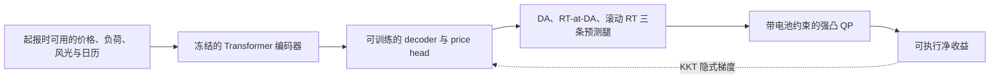

# Electricity Price Forecasting

> 目标：**提高储能在电力市场中的可执行净收益**，而不只是降低电价预测误差。

## 项目状态

| 项目 | 当前口径 |
| --- | --- |
| 主线方法 | 端到端 decision-aware 训练；冻结 Transformer 编码器，只微调 decoder 与 price head |
| 决策层 | 三条价格预测腿进入带电池约束的强凸 QP |
| 训练信号 | 通过 KKT 隐式微分，将真实收益梯度传回预测模型 |
| 验证顺序 | 2023 开发评价 → 2024 冻结确认 → 2025 锁定跟进 |
| 外部验证 | 奥地利原生 15 分钟市场，严格零样本迁移 |
| 当前阶段 | 方法、外部验证和论文材料整理；尚未进入论文冻结或投稿准备 |

Router、尾部适配和经济价差分解只保留作历史对照与负结果，不代表当前主线。

## 方法概览



编码器保持冻结，因此这是“决策目标端到端、部分参数微调”，不是全参数端到端训练。

## 核心结果

| 评价阶段 | v4 净收益（USD/节点·日） | 对照 | 结论 |
| --- | ---: | --- | --- |
| 2023 开发评价，不使用 ERCOT 训练标签 | 430.41 | pooled LOMO XGBoost：418.06 | 同信息预算下更高 |
| 2024 冻结确认，不参与选模 | 106.86 | 逐节点 XGBoost：90.69 | 跨年优势保持 |
| 2025 四市场历史数据重训后跟进 | 69.54 | DLinear、既有 Router 等 13 套流程 | 排名第 1；较 DLinear +13.03%，较 Router +9.47%；SOC 违规为 0 |

证据入口：

- [v4 冻结与 2024 外层确认](docs/progress/7_端到端Decision-aware重启与跨年验证/3_v4冻结与2024外层确认.md)
- [2025 锁定跟进](docs/progress/7_端到端Decision-aware重启与跨年验证/4_2025锁定跟进.md)
- [奥地利 15 分钟外部验证](docs/progress/100_奥地利15分钟外部验证/)

奥地利数据不参与训练、选模或 seed 选择。该结果只用于检验冻结模型的跨市场、跨频率迁移能力。

## 数据与复现

| 路径 | 是否随仓库提供 | 用途 |
| --- | --- | --- |
| `data/markets/{CAISO,ERCOT,NYISO,PJM}/*.parquet` | 是 | 四市场冻结小时数据；正式训练唯一入口 |
| `data/markets/*/*.xlsx` | 否，本地忽略 | 同名源工作簿；与 Parquet 重复，不是运行依赖 |
| `data/Austria/` | 是 | 奥地利 15 分钟零样本外部评价 |

数据合同：

- 克隆仓库后即可获得四市场 Parquet，无需另行解压数据包；
- 不覆写已提交的冻结 Parquet；数据更新使用新的日期范围或版本标识；
- 当前输入为历史 DA 价格、历史 RT 价格、历史负荷、历史风光和本地日历；
- 未来实际负荷、风光或天气不能冒充起报时可用的预报；
- 时间戳与 `hour_local` 一致，按小时区间起点解释；Parquet 未保存区间语义的来源元数据，此限制必须在报告中保留。

ERCOT DA 样本按交付日前一天 10:00 Central Prevailing Time 截断输入，预测次日完整 24 小时交付日。旧 v8 相邻滑窗只作历史对照。

## 常用检查

审计当前 DA 样本：

```powershell
& external/toto/.venv/Scripts/python.exe -X utf8 scripts/decision_aware/audit_da_sample.py
```

运行数据与收益单元测试：

```powershell
& external/toto/.venv/Scripts/python.exe -X utf8 -m pytest -q `
  tests/test_decision_aware_dataset_da.py `
  tests/test_decision_aware_dataset_v3.py `
  tests/test_decision_aware_policy.py
```

独立模型 smoke 检查：

```powershell
& external/toto/.venv/Scripts/python.exe -X utf8 scripts/decision_aware/train_da.py --smoke
& external/toto/.venv/Scripts/python.exe -X utf8 scripts/decision_aware/train_rt.py --smoke
```

环境依赖见 [`requirements.txt`](requirements.txt) 和 [`requirements-windows-cuda.txt`](requirements-windows-cuda.txt)。

## 仓库导航

| 入口 | 内容 |
| --- | --- |
| [`BASELINES.md`](BASELINES.md) | 冻结基线与比较规则 |
| [`configs/decision_aware/`](configs/decision_aware/) | 当前模型配置 |
| [`src/decision_aware/`](src/decision_aware/) | Transformer、损失、策略和数据入口 |
| [`src/models/`](src/models/) | 季节性、树、RNN 和 Foundation 基线适配 |
| [`src/evaluation/`](src/evaluation/) | 回测与指标 |
| [`scripts/decision_aware/`](scripts/decision_aware/) | 当前审计、训练和比较入口 |
| [`tests/`](tests/) | 数据合同与收益正确性测试 |
| [`docs/README.md`](docs/README.md) | 文档状态与阅读顺序 |
| [当前 decision-aware 阶段索引](docs/progress/7_端到端Decision-aware重启与跨年验证/5_阶段索引.md) | 当前主线实施记录 |
| [历史总索引](docs/progress/1_总索引与基础单节点流程/1_阶段索引.md) | 旧阶段追溯入口 |
| [`paper/decision_aware_latex/`](paper/decision_aware_latex/) | 当前 LaTeX 论文材料 |

`docs/archive/`、`scripts/archive/`、`src/archive/` 和 `configs/archive/` 默认不运行、不维护。`runtime_cache/`、`external/`、模型 checkpoint 和逐时实验产物均为本地内容，不进入仓库。

## 相关仓库与文献

- Chronos-2：[amazon-science/chronos-forecasting](https://github.com/amazon-science/chronos-forecasting)
- TimesFM：[google-research/timesfm](https://github.com/google-research/timesfm)
- Toto：[DataDog/toto](https://github.com/DataDog/toto)
- 项目文献与阅读索引：[`docs/reference/README.md`](docs/reference/README.md)
- Transformer 入门材料：[`docs/concepts/transformer_from_scratch.md`](docs/concepts/transformer_from_scratch.md)
- 三日学习计划：[`docs/concepts/transformer_3day_learning_plan.md`](docs/concepts/transformer_3day_learning_plan.md)
